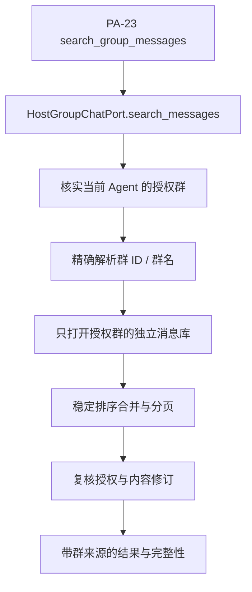

# 跨群搜索设计方案

## 1. 元信息

| 项 | 值 |
| --- | --- |
| 建档日期 | 2026-10-17 |
| 范围 | JM-21 的跨群搜索子范围；后续其他 IM 平台扩展不在本方案实施范围 |
| 方案成熟度 | 已确认；跨群宿主子范围已实现，整项 JM-21 仍进行中 |
| 计划条目 | [JM-21](../designs/jiuwenmate-development-plan.md#jm-21-跨群搜索与-im-扩展扩展) |
| 负责人 | 常钰聪（沿用开发计划；本次建档不调整责任人） |
| 状态 | 进行中（跨群宿主子范围已实现并通过本地测试；真实飞书及 JM-21 其他 IM 扩展未验收） |
| 设计依据 | agent-core 仓 `openjiuwen/harness/persistent_agent/docs/features/F_23_group-chat-history-retrieval.md` 与 `docs/specs/S_09_group-chat-and-knowledge.md`；[本仓服务端架构](../designs/jiuwenmate-architecture.md)的宿主授权职责 |
| 关联 feature | 前置：[F_11 群公共记录](F_11_group-public-records.md)；接入：[F_08](F_08_feishu-group-fanout.md)、[F_07](F_07_execution-driver.md)、[F_10_02](F_10_02_web-private-chat.md) |
| 验证摘要 | JM-21 聚焦单测、执行链接线与真实 core 集成 26 项通过；整组单测／集成回归 345 passed、14 failed（5 项为开发前既有基线失败，9 项受本地 agent-core PA-18 配置限制），真实飞书成员核验未执行，JM-21 整项未完成 |
| Refs | 开发计划 JM-21；用户已确认跨群只检查 Agent 对目标群的授权，不要求提问者属于目标群 |

## 2. 背景、目标与范围

目标是让用户在 Web／飞书私聊或群 A 中，向同一个 Agent 查询它获授权群 B 的历史。PA-23 已提供 `search_group_messages`，可信主体固定为当前 Execution 的 Agent；JiuwenSwarm 负责当前授权范围与实际数据查询。

计划原先“GroupChatPort 不能跨群、对端契约待设计”的前提已由本地 PA-23 更新。本方案消费新契约，不重新实现模型工具、参与判断或窗口补读。JM-11 提供每群归档和底层搜索，JM-21 负责目标解析、跨库合并与搜索开放。

本次只设计和实现跨群搜索，不处理其他 IM 平台扩展。也不开放其他 Session 的私有窗口、私聊历史、跨 Agent 查询、向量语义搜索或命中邻居读取工具；JM-21 的其他平台子范围仍按开发计划单独跟踪，不能因跨群搜索完成就标记 JM-21 整项完成。

## 3. 设计约束、假设与待决问题

- 目录和访问表只引用 F_11，不另定义一套布局或权限表；每个群位于 `group_messages/<group_id>/`，无 namespace 目录层。
- 授权主体由可信 `execution.namespace_id` 和 `execution.agent_id` 决定，不从模型接收 Agent、Session、所有者或授权列表。当前提问者是否为目标群成员不参与搜索授权。
- 每次调用（包括分页）核对当前 Agent—app 绑定、Bot 当前群成员状态和可见历史下界；旧游标、旧 Request 或配置快照不能充当授权。
- `group_details` 当前群名存储及更新入口已存在。实现通过 `active_accesses` 枚举候选关系，逐一实时核验 Bot 成员状态后才读取当前名称、解析目标或打开归档；本地替身验证不等于真实飞书核验。
- 用户通常以群聊名称指定目标，因此群名到群 ID 的解析是跨群搜索主路径。复用 JM-11 `group_details(namespace_id, group_chat_id, name)` 当前群名数据，不另建映射表；只在当前已核验授权的群集合内解析，不能查询全局名称目录后再过滤。
- 群名使用当前已保存名称精确匹配，不做模糊搜索或历史别名匹配；若授权范围内重名，返回仅含授权群稳定 ID 的消歧提示；无匹配或名称不在授权范围时返回通用不可用，不透露其他群是否存在。
- 数据源为所有者本地已保存群记录，当前授权不代表已保存完整平台历史。

## 4. 总体方案与设计取舍

### 4.1 查询流程

图中各群库分别读取，不承诺跨库、授权表与远端平台具有同一个原子快照；以最后一次授权核验和内容修订检查作为本次返回依据，变化时拒绝旧页或返回不完整。

### 4.2 关键决策

- **D-01 复用一个工具和端口。** PA-23 处理模型参数与结果展示，宿主实现 `GroupChatPort.search_messages`；不另加 `cross_group_search` 工具。
- **D-02 先确认目标，再读库。** 未指定群时搜索该 Agent 全部当前授权群；过滤只能缩小范围，不能扫描整个目录后再过滤结果。
- **D-03 各群独立保存，程序合并有限结果。** 接受多库查询代价；首期不复制正文到中央搜索库、不先建设向量索引。
- **D-04 新读取重新授权，旧上下文不自动擦除。** 撤权后拒绝后续搜索；已经进入模型窗口的工具消息按既有窗口规则保留，失效传播不在本项承诺内。

真实候选中，沿用“当前 Session 群”作为搜索默认范围会违背 PA-23，已排除；全目录扫描后过滤可能先读取无权群，已排除。物理集中消息库的方案已由用户选择的每群目录布局替代。

## 5. 详细设计

### 5.1 参数与目标解析

复用 core 公共导出的 `GroupMessageQuery`、`GroupMessageSearchHit`、`GroupMessageSearchResult`。至少提供关键词、时间或发送者之一，limit 默认 50、最大 500；群 ID／群名各最多 128 项。模型不提供 namespace 或 Agent 身份。

群聊名称是面向用户的目标输入，群 ID 是内部归档定位键。解析顺序固定如下：

1. 从可信 Execution 取得 namespace 与 Agent，枚举该 Agent 的 active 群访问关系，并实时核验唯一 app 对应的 Bot 当前仍在群内；状态未知、重复 active app 或核验异常安全失败。未通过核验的群不得进入名称解析或归档读取。
2. 只对通过核验的授权群 ID 调用 `GroupChatRepository.known_name_of(namespace_id, group_id)` 取得显式保存的当前名称，形成本次查询作用域内的名称→ID 对应。名称事实复用 `group_details`；JM-11 的飞书群事件和成员核验流程负责刷新名称。名称缺失时只能用 ID 定位，不能伪造名称匹配；搜索命中展示名称缺失时沿用底层契约以稳定 group_id 作为来源标签。
3. 用户提供群名时按当前名称精确匹配，不做模糊匹配、历史别名匹配或全局目录搜索。唯一匹配解析为对应 group_id 后，才打开该群归档；无匹配或名称不在授权范围时整次返回通用 unavailable，不透露其他群是否存在。
4. 若多个已授权群使用相同名称，返回仅包含这些已授权群稳定 ID 的消歧提示，不读取其中任意群，也不泄露授权范围外的同名群。用户可改用稳定 ID 或更具体的名称条件重试。

无群过滤时使用整个已核验授权集合；同一字段内多个值取并集，同时提供 ID 与名称时取两个过滤集合的交集。任何指定目标不能安全解析或无权时整次返回通用 unavailable，不悄悄丢掉该目标后假装搜索完整。

授权服务正常且没有未解决关系、确认授权集合为空时可返回完整 empty；当前 active 候选核验未知会失败关闭，指定 group_id 存在未解决 unknown 关系或无过滤全范围含未解决关系时返回 unavailable。来源 `binding:` 的 unknown 表示已确认退休的旧 Bot 绑定，不属于当前候选。不读取私聊 Session、PA 窗口或旧版群记录。

### 5.2 跨群检索与分页

1. 校验 Execution 与当前宿主绑定归属，取得当前授权集合、可见时间下界与访问关系修订信息。
2. 解析过滤条件并只打开已确认授权群的归档；归档入口核对每库 namespace／group 身份，记录首轮最大 `ingest_seq`、正文修订号和缺口状态。
3. 每群在固定入库上界内最多查询 limit 条候选，关键词采用 F_11 的 Unicode 字面子串规则；按接收时间降序，再按 `group_id`、`message_id` 升序排序，全局合并后取前 limit 条。任何新增入库都不进入本次分页快照。
4. 若仍有后续结果，返回 incomplete、`query_complete=false`、明确分页原因和 next_cursor；全部目标的请求范围已完整扫描时，非空返回 found，为空返回 empty。结果只代表本地保留范围，不能称平台全量历史。
5. 返回前再次检查目标授权和正文修订；撤权／解绑拒绝旧页，正文发生编辑或撤回则要求从头查询，不使用旧页缓存返回旧正文。当前读取过程中观察到的限制以安全状态反映。

时间端点、字面匹配等底层规则由 F_11 唯一维护。没有时间条件时查询所有实际保留且处于可见范围内的历史，不默认限制为最近若干天。

分页不能把所有群状态直接塞进 core 的 cursor 字段。实现使用不可预测的 URL-safe 随机 token，状态存 `agents.sqlite3` 的 `group_search_cursors`：绑定 namespace、Agent、规范化查询摘要、目标群、各群固定扫描上界、内容／授权修订、最后排序键与过期时间。数据库只保存 token 的 SHA-256 摘要，不存原 token、正文或文件路径；有效期为 15 分钟，签发时清理已过期行。token 不作为权限证明。

后续页必须提供相同查询条件，重新核实全部目标当前授权，并按保存上界和全局最后排序键查询。查询摘要排除 cursor 且规范化 ID／名称集合。新增消息在新查询出现，不混入旧分页；授权关系修订、来源绑定、可见下界、已存群名或正文修订变化使旧页失效。无效、跨 Agent 或跨 namespace 的游标不透露原查询内容。游标可重复使用以重读同一页，但每次仍鉴权及复核正文修订，不缓存旧正文结果。

任一群库失败或存在无法证明覆盖的缺口时，不返回完整 found／empty；可返回已确认命中与 incomplete，且不发放冒充连续完整扫描的分页位置，调用者缩小范围或重新查询。无可靠结果时返回 failed。不得为了“有一些结果”而读取无法核实权限的群。

### 5.3 来源、错误与附件

每条命中包含内部 group_id、当前群名、稳定 message_ref 与 GroupMessage；引用由宿主从可信群和消息身份生成，不使用物理文件路径。群名尚未核实时以稳定群 ID 展示，不制造可按名称精确定位的假群名。群名解析只在已核验授权集合中完成；搜索结果中的群名不能反向扩大后续查询的授权范围。

返回值携带本次 InvocationRef，按 core 契约区分完整、未完成、不可用和失败。原因是对模型安全的说明，不包含 SQL、文件路径、凭据或无权群存在性。正文撤回／不可用保持 text 为空，附件引用只返回当前可授权内容。全文展示截断由 PA-23 负责，宿主不把省略正文伪装成原文完整内容。

### 5.4 接入与能力开放

`HostGroupChatPort` 实现和当前群读取沿用 JM-11；本项扩展其 PA-23 搜索实现。`ExecutionDriver` 在群存储存在时为 `direct_message` 与 `group_message` Persistent Execution 注入带 `ConversationSearch` 和 cursor repository 的群端口；只对 `group_message` 继续预检 `current_trigger`。scheduled execution 不注入群搜索端口；Web／飞书私聊可以搜索 Agent 授权群，但不因此要求 Session 属于群。当前本地 PA-23 以端口是否注入注册工具，不增加 `enabled_features` 新字段；个人版及集群模式装配不变。

自动当前群背景仍由 core 仅在 group_message Request 中读取；PA-07 独立参与判断不受跨群工具影响。当前宿主子范围已实现；真实飞书成员核验或存储设施未配置时，搜索失败关闭，不把无群过滤请求降级成仅搜索当前群。

## 6. 影响面与实施设计

| 顺序 | 修改点 | 责任与可独立验证产物 |
| --- | --- | --- |
| I-01 | `group_chat_repository.py`、F_11 每群归档与访问关系 | 枚举当前 Agent 关系，核验成员并复用群名数据；不新增权限或群名表 |
| I-02 | `conversation_search.py`、`ports/group_chat.py` | 固定每群快照、授权内精确群名解析、多库合并与完整性状态 |
| I-03 | `group_search_cursor_repository.py`、现有 `agents.sqlite3` | 15 分钟不透明游标、查询与 Agent 绑定、每页重授权；只存摘要和分页元数据 |
| I-04 | `execution_driver.py` | 在 direct_message／group_message Persistent 执行中注入搜索能力，scheduled 和个人版接线不变 |
| I-05 | `test_cross_group_search.py`、`test_session_scheduler.py`、`test_cross_group_search_real_core.py` | 授权隔离、分页失效、模式接线和真实 core PA-23 工具调用 |

公共 DTO 沿用 agent-core PA-23，本仓通过 S_01 维护宿主授权和查询契约，不复制 core Schema。JM-21 仍属扩展，不纳入本期 S2a，也不调整原负责人。整体架构文件未修改。

## 7. 兼容与迁移

依赖本地 PA-23 的新搜索结果，旧仅返回 `GroupMessagesResult` 的宿主不得冒充跨群实现。搜索身份不依赖 Request 的工作空间 scope，不扩大 workspace_read，不引入私有窗口检索。仅使用新版目录与数据库，不读取旧版数据。

每群数据库独立，查询取消后释放各连接；工作线程已开始的只读操作可能完成，但不因此发起新的页读取或写业务 Request。搜索游标清理只清自己的临时记录，不删群消息或 Agent 状态。

## 8. 验证设计、执行记录与结论

沿用计划 **JM-21-V-01**，拟使用真实临时 SQLite 与真实 PA-23，平台成员检查先用可控替身，再用测试群验证：

- Agent A 访问群 1、群 2，Agent B 只访问群 2；从 A 私聊或群 1 以群聊名称搜索群 2，名称解析到正确 group_id 且来源和结果正确；B 不能借群 ID、群名或 A 的游标访问群 1。
- 无群过滤、名称→ID 精确解析、名称未命中、授权范围内同名消歧、授权范围外同名不泄露、联合 ID／名称过滤、字面 `%`／`_`、跨群同时间稳定排序与分页，无跳漏或重复。
- 第一页后退群、解绑、成员核验失败、消息撤回或编辑，旧页不能继续泄露正文；私有窗口、旧归档和其他 namespace 数据不被打开。
- 一个群故障、库缺失或已知采集缺口不能返回完整 empty；构造过多群状态仍返回合法长度游标。
- 通过真实 DeepAgent 工具调用验证 private／group 搜索与只读意图分类，个人版工具集和自动背景行为回归；平台真机与模型替身结果分别记录。

**JM-21-V-02** 的其他平台扩展未设计、未执行，不以本方案代替其验收。

| 执行日期 / 验证范围 | 实现版本与环境 | 命令 / 复现步骤 / 记录链接 | 实际结果 | 未覆盖项 / 失败原因 |
| --- | --- | --- | --- | --- |
| 2026-10-17；JM-21 跨群单测、执行链及 core 集成 | Windows 本地；真实临时 SQLite、agent-core PA-23 真实执行组件、模型与飞书成员服务为替身 | `uv run pytest -o "addopts=--asyncio-mode=auto" -q tests/unit_tests/server/jiuwenmate/test_cross_group_search.py tests/unit_tests/server/jiuwenmate/test_session_scheduler.py::test_direct_message_gets_search_port_without_group_trigger_preflight tests/unit_tests/server/jiuwenmate/test_session_scheduler.py::test_scheduled_execution_does_not_get_group_search_port tests/unit_tests/server/jiuwenmate/test_session_scheduler.py::test_group_message_keeps_current_trigger_preflight_and_search_port tests/integration_tests/jiuwenmate/test_cross_group_search_real_core.py` | 26 passed；另 `uv run pytest -o "addopts=--asyncio-mode=auto" -q tests/unit_tests/server/jiuwenmate/test_group_chat_port.py` 为 17 passed | 未使用真实飞书凭据或 Gateway 连接；不覆盖真机成员核验、实时平台历史完整性及其他 IM 平台 |
| 2026-10-17；JiuwenMate 全目录单测与集成回归 | Windows 本地；含本地 agent-core 工作区依赖 | `uv run pytest -o "addopts=--asyncio-mode=auto" -q tests/unit_tests/server/jiuwenmate tests/integration_tests/jiuwenmate` | 345 passed，14 failed | 5 项与 JM-21 开发前的 Windows／本地 core 基线失败相同（容量校验顺序、POSIX 权限位、Windows symlink 权限）；另 9 项 `test_web_real_core.py` 因本地 agent-core 执行要求 PA-18 capacity 配置而失败。JM-21 针对测试全通过；不修改这些范围外配置／测试 |

已证明范围：跨群授权先于归档读取、群名仅在授权群内精确解析、跨群稳定搜索与续页重新授权，以及 direct-message 的真实 PA-23 工具链可在本地真实 SQLite 场景工作。个人版路径未在该新增代码中改接；原有当前群端口回归通过。

未覆盖或未通过的承诺：真实飞书 Bot 成员检查、群名刷新、Gateway／AgentServer 真实跨群查询，以及 JM-21-V-02 的其他 IM 扩展尚未验证或设计。

可支持的交付判断：跨群搜索宿主组件子范围已实现并通过所列本地验证；不能据此将 JM-21 整项标为完成或宣称真实飞书端到端闭环。

## 9. 风险与已知遗留

- 真实飞书成员核验、群名刷新和跨群私聊联调尚未执行；本地替身不能证明 Gateway 或 SDK 的真实响应符合当前授权判断。JM-11 的平台与生产配置遗留同样会影响真实闭环。
- SDK 成员状态核验与事件完整性必须在真实应用验证；最终授权复核不承诺远端平台与本地多库具有全局原子快照。
- 群数量与保留数据量会影响多库检索性能，先按真实负载测量，再决定是否增加索引；不以方案设定未经测量的性能目标。
- 真实执行须对齐最新 core 的 PA-18 容量配置及计数能力；无需等待 PA-11／12 实现才能开发归档和跨群搜索。
- 其他 IM 平台仍未排期；整项 JM-21 不能因本子范围完成而标记完成。

## 10. 设计演进与修订

2026-10-17：以本地已实现的 PA-23 替代“GroupChatPort 不支持跨群”的旧前提；按用户确认的每群独立目录、无 local 路径层落地设计。群访问关系仍归宿主，权限主体仍为 Agent，不要求提问者是目标群成员。补充确认：用户可按群聊名称指定目标，复用 JM-11 当前群名并仅在实时核验后的授权集合内解析到 group_id；精确匹配，重名安全消歧，不建额外映射表。该段记录的是建档时的方案状态。

2026-10-17 实施更新：完成 JM-21 跨群宿主子范围，包括授权群枚举与精确名称解析、固定群归档快照及全局分页、15 分钟哈希游标、逐页授权和正文修订复核，以及 direct_message／group_message 执行链注入。验证见 §8；真实飞书与其他 IM 平台仍未验证／未设计，原负责人和扩展分类未变。
