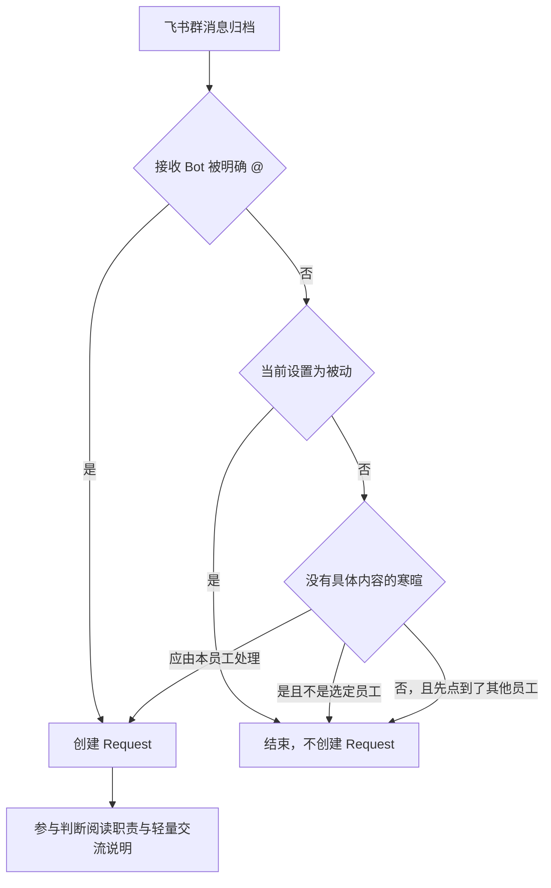

# 员工群聊回复模式

## 1. 元信息

| 项 | 值 |
| --- | --- |
| 建档日期 | 2026-10-21 |
| 范围 | 每位员工在飞书群中的被动 / 自适应回复；入站是否创建 Request；群执行前的职责与轻量交流说明 |
| 方案成熟度 | 已确认（按当前实现与已拒绝方案记录；真实飞书群未验收） |
| 计划条目 | [JM-23](../designs/jiuwenmate-development-plan.md) |
| 负责人 | 常钰聪 |
| 状态 | 待验收（宿主组件已有实现和定向测试；真实飞书与浏览器未验收） |
| 设计依据 | [F_08 飞书接入与群内分发](F_08_feishu-group-fanout.md) 的入站受理；[F_02 同事定义与配置发布](F_02_colleague-management.md) 的当前设置；core `judge_participation` 在明确 @ 时直接 `respond` |
| 关联 feature | 前置：[F_02](F_02_colleague-management.md)、[F_07](F_07_execution-driver.md)、[F_08](F_08_feishu-group-fanout.md)、[F_10](F_10_web-colleague-management.md)。群内交接仍由 [F_09](F_09_web-and-feishu-result-delivery.md) 负责 |
| 验证摘要 | 回复模式、纯寒暄分流、职责附加说明和恢复路由的宿主测试已通过。真实飞书群与浏览器未执行。 |
| Refs | 无独立 issue；需求来自飞书群需要按员工区分「仅被 @ 才回复」和「按职责判断是否参与」 |

## 2. 背景、目标与范围

飞书群消息原先在归档后就会为每位已绑定员工创建 Request，再由参与判断决定是否回答。没有按员工关闭主动参与的开关，也没有把职责外的具体任务和面向群成员的轻量交流分开。

本次让每位员工单独保存群聊回复模式。被动员工只在飞书群里被明确 @ 时创建 Request。自适应员工继续进入参与判断：具体任务按职责决定，轻量日常交流从宽并简短回应，没有具体内容的寒暄只由一位自适应员工受理。

本次不包含：切换模式后重放已经跳过的旧消息；私聊开关；按关键词表匹配用户原话；修改 core 的参与判断指令；把宿主测试写成真实飞书验收。

## 3. 设计约束、假设与待决问题

- 已确认约束与依赖：群公开记录仍按群隔离，见 [F_11](F_11_group-public-records.md)。同一条群消息仍按接收 Bot 逐员工处理，见 F_08。明确 @ 时 core 在调用模型前返回 `respond`。交接标记、公开消息接力及「由你判断」仍属于 F_09 的群内协作说明。
- 关键假设：入站时 `read_settings` 读到的是该员工当前设置，而不是已发布 Spec 的指纹。设置尚未写入该字段时按 `adaptive`。
- 待决问题：无。真实飞书上模型是否遵守职责说明，留到验收，不在本文改成硬过滤。

## 4. 总体方案与设计取舍

### 4.1 方案概览

员工详情保存 `group_reply_mode`，取值只有 `passive` 与 `adaptive`，缺省为 `adaptive`。飞书群消息先写入该群公开记录。接收 Bot 被明确 @ 时直接创建 Request。否则读取当前设置：被动模式到此结束，不创建 Request。自适应模式继续判断纯寒暄和是否应等待先被点名的员工，然后才受理。执行前把职责边界和轻量交流说明放进 `system_prompt_addendum`，参与判断在 core 指令之后阅读这段说明。

箭头表示一条群入站的判断顺序。被动分支不调用调度器受理。

### 4.2 关键决策

#### D-01 模式在入站时生效，不重放旧消息

- 选择与依据：被动时消息已经归档并结束，没有 Request。恢复只接手已创建且未完成的 Request。打开自适应后，下一条新消息才按新模式处理。
- 代价与成立条件：用户必须重新发送刚才被跳过的问题。
- 实现体现：`PersistentGroupFanout` 在 `scheduler.accept` 之前返回。
- 相关候选：未另做归档扫描补建 Request。

#### D-02 被动是硬门闩，自适应仍由模型判断职责

- 选择与依据：被动表示该员工不参与未被 @ 的群消息。自适应保留参与判断，避免用词表代替职责。明确 @ 不经过这道门闩，core 仍直接 `respond`。
- 代价与成立条件：自适应不保证每条群消息都有回复。模型可以不遵守附加说明。
- 实现体现：`group_reply_mode == "passive"` 时返回已处理；`build_group_execution_guidance` 始终带上职责说明。
- 相关候选：R-01。

#### D-03 纯寒暄只交给一位自适应员工

- 选择与依据：没有具体内容的寒暄若让每位自适应员工各建一条 Request，会同时回复。优先选择名称或职责说明中含「生活」的自适应员工；该员工为被动时，按姓名和 `agent_id` 稳定选择下一位自适应员工。
- 代价与成立条件：寒暄后还带着具体任务的消息不是纯寒暄，仍按职责判断。名单为空时不指定应答人，当前自适应员工仍可受理。
- 实现体现：`is_pure_greeting` 与 `greeting_respondent`。
- 相关候选：R-02。

#### D-04 轻量交流只描述类别，不写入举例原话

- 选择与依据：面向群成员的寒暄、近况、随口闲聊和询问各位自身情况，用一两句回应；询问大家各自的情况时只介绍自己。具体任务与职责无关时仍为 `ignore`，不因还没有同事回复而补位。
- 代价与成立条件：类别边界由模型判断。职责外的具体任务没有第二道关键词拦截。
- 实现体现：`group_collaboration.py` 的职责说明。
- 相关候选：R-03。

### 4.3 替代方案与排除理由

| 候选 / 关联决策 | 候选目的与关键差异 | 拒绝或暂缓原因 | 重新评估条件 |
| --- | --- | --- | --- |
| R-01 / D-02 用关键词决定一切群消息 | 入站按词表直接回复或忽略 | 职责和轻量交流都会变化，词表会把未列出的同类消息挡掉 | 需要可审计的硬规则，且不再依赖参与判断 |
| R-02 / D-03 每位自适应员工都回复寒暄 | 避免指定某一位员工 | 同一句寒暄会出现多条回复 | 产品要求每位员工都必须出面寒暄 |
| R-03 / D-04 把具体问法写进提示词 | 用例子锁定模型 | 例子会被当成唯一范围，也会把个别问法固化进提示词 | 无 |

## 5. 详细设计

### 5.1 模块责任与关键不变量

- `ColleagueSettings.group_reply_mode` 只接受 `passive` 或 `adaptive`。`ColleagueView` 带出同一字段。未知取值拒绝保存。
- 员工详情在渠道区域展示「群聊回复模式」。被动说明为「仅在飞书群聊中被 @ 时回复。」自适应说明为「被 @ 时回复，其他群消息根据身份职责自主判断是否参与。」保存后发布再读回当前值。
- 飞书私聊不读取该字段。群消息没有飞书原生 @ 时，正文里的姓名不算被 @。
- 纯寒暄的全匹配只覆盖没有后续要求的问候。带具体任务的句子即使以问候开头，也不走寒暄分流。
- 参与说明要求具体任务与职责完全无关时 `ignore`，轻量日常交流从宽判断。这段说明附在群执行上；没有其他群成员时仍然保留职责说明，不附带交接规则。

### 5.7 正常执行流程

1. 员工详情写入 `passive` 或 `adaptive`，并发布。
2. 飞书群消息归档。接收 Bot 被明确 @ 时，把该员工内部 ID 放入本次 Request 的提及名单并受理。
3. 未被 @ 且当前设置为被动时结束。公开记录保留这条消息。
4. 未被 @ 且为自适应时，纯寒暄只受理选定员工；用户先点名另一位在群员工时，其余员工等待该员工的公开回复。
5. 已受理的群 Request 在参与判断中阅读职责与轻量交流说明。决定回答后，仍走原有执行和投递。

切换模式不会为第 3 步已经结束的消息补建 Request。

### 5.8 异常、中断与重试处理

设置取值非法时拒绝保存，不改变已保存的模式。参与判断忽略该消息时，Request 以 `ignored` 结束，不产生群回复。模型未遵守附加说明时，宿主不在投递前按关键词删掉回复。

## 6. 影响面与实施设计

### 6.1 修改点与实施顺序

| 实施项 | 模块 / 文件或符号 | 修改内容与责任 |
| --- | --- | --- |
| I-01 | `models.py` | 设置与视图增加 `group_reply_mode`，缺省 `adaptive` |
| I-02 | 员工详情页、`jiuwenmateApi.ts`、中英文文案 | 展示并保存两种模式 |
| I-03 | `feishu_group_fanout.py` | 被动、纯寒暄和点名等待都发生在受理之前 |
| I-04 | `group_collaboration.py`、`execution_driver.py` | 生成并附上职责与轻量交流说明 |

飞书恢复按路由分开接手，避免 Web 运行时处理它无法核验群成员的飞书 Request。该修正属于 [F_13](F_13_recovery.md)，不改变本特性的入站规则。

## 8. 验证设计、执行记录与结论

### 8.1 验证设计与通过条件

| 验证 ID | 场景 | 预期结果 |
| --- | --- | --- |
| JM-23-V-01 | 被动且未被 @ | 群消息归档后不创建 Request |
| JM-23-V-02 | 被动但飞书明确 @ 该员工 | 创建 Request |
| JM-23-V-03 | 自适应且问题与职责无关 | 创建 Request 后，参与说明要求 `ignore`；是否遵守由模型决定 |
| JM-23-V-04 | 纯寒暄 | 只有一位自适应员工得到 Request；优先名称或职责说明含「生活」的员工 |
| JM-23-V-05 | 被动期间跳过的消息随后改为自适应 | 不补建 Request；新消息才按自适应受理 |

### 8.2 实际执行与证据

2026-10-21，在 `fork/huenrui_jiuwenswarm` 工作区执行，未提交。

| 命令 | 结果 | 覆盖内容 |
| --- | --- | --- |
| `uv run pytest tests/unit_tests/server/jiuwenmate/test_group_collaboration.py tests/unit_tests/gateway/test_persistent_group_fanout.py::test_a_pure_greeting_is_accepted_only_for_one_daily_colleague tests/unit_tests/gateway/test_persistent_group_fanout.py::test_later_named_colleague_waits_for_the_first_public_reply tests/unit_tests/server/jiuwenmate/test_session_scheduler.py::test_group_execution_preserves_verified_bot_mention_after_trigger_refresh --no-cov -q` | 通过 | 职责说明、纯寒暄分流、点名等待和群执行附加说明 |
| `uv run pytest tests/unit_tests/server/jiuwenmate/test_recovery_service.py::test_web_recovery_leaves_a_dispatched_feishu_request_for_the_feishu_runtime --no-cov -q` | 此前已通过 | Web 恢复不接手飞书 Request |

前端 `tests/jiuwenmateProfile.test.mjs` 与 `tests/jiuwenmateApi.test.mjs` 已补充模式字段。本次建档未重跑浏览器。

### 8.3 验证结论

宿主组件覆盖了被动门闩、纯寒暄只受理一位员工，以及职责说明会进入群执行。真实飞书群中的模型判断和页面切换尚未验收，JM-23 保持待验收。

## 9. 风险与已知遗留

| 遗留项 | 影响与现有处置 | 后续入口 |
| --- | --- | --- |
| 参与判断仍是模型决定 | 自适应员工可能回答职责外的具体任务，或忽略轻量交流 | 真实飞书验收；需要硬规则时重新评估 R-01 |
| 切换模式不重放 | 被动期间的消息不会在打开自适应后自动回答 | 保持 D-01，由用户重新发送 |
| 发布耗时可能导致页面超时 | 设置可能已经写上，页面提示超时后高亮回到旧值 | 不在本特性改变发布超时 |
