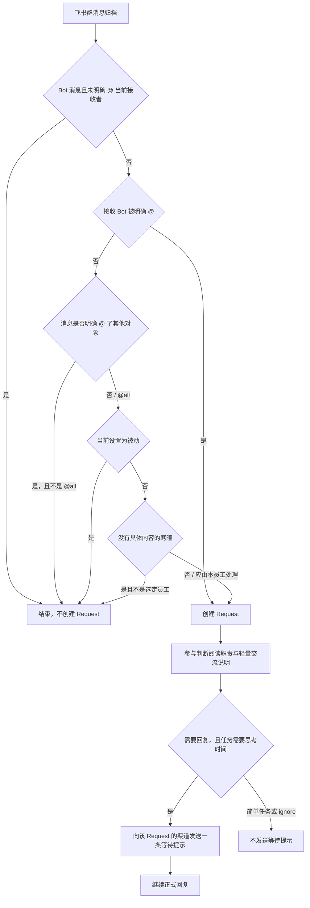

# 员工群聊回复模式

## 1. 元信息

| 项 | 值 |
| --- | --- |
| 建档日期 | 2026-10-21 |
| 范围 | 每位员工在飞书群中的被动 / 自适应回复；入站是否创建 Request；群执行前的职责与轻量交流说明；仅当参与判断认定任务需要思考时间时，投递其写入的等待提示 |
| 方案成熟度 | 已确认（按当前实现与已拒绝方案记录；真实飞书群未验收） |
| 计划条目 | [JM-23](../designs/jiuwenmate-development-plan.md) |
| 负责人 | 常钰聪 |
| 状态 | 待验收（宿主组件已有实现和定向测试；真实飞书与浏览器未验收） |
| 设计依据 | [F_08 飞书接入与群内分发](F_08_feishu-group-fanout.md) 的入站受理；[F_02 同事定义与配置发布](F_02_colleague-management.md) 的当前设置；core `judge_participation` 在明确 @ 时仍记 `respond`，并判断是否需要等待提示 |
| 关联 feature | 前置：[F_02](F_02_colleague-management.md)、[F_07](F_07_execution-driver.md)、[F_08](F_08_feishu-group-fanout.md)、[F_10](F_10_web-colleague-management.md)。群内交接仍由 [F_09](F_09_web-and-feishu-result-delivery.md) 负责 |
| 验证摘要 | 回复模式、纯寒暄分流、职责附加说明、等待提示和恢复路由的宿主测试已通过。真实飞书与其他渠道未执行。 |
| Refs | 无独立 issue；需求来自飞书群需要按员工区分「仅被 @ 才回复」和「按职责判断是否参与」 |

## 2. 背景、目标与范围

飞书群消息原先在归档后就会为每位已绑定员工创建 Request，再由参与判断决定是否回答。没有按员工关闭主动参与的开关，也没有把职责外的具体任务和面向群成员的轻量交流分开。

本次让每位员工单独保存群聊回复模式。被动员工只在飞书群里被明确 @ 时创建 Request。自适应员工对未明确指向其他对象的人类群消息进入参与判断：具体任务按职责决定，轻量日常交流从宽并简短回应，没有具体内容的寒暄只由一位自适应员工受理。若消息用飞书原生 @ 明确点名其他人或 Bot，未被点名的员工只归档，不创建 Request；`@all` 仍按群广播进入自适应判断。普通 Bot 群消息按 F_08 先归档、后结束，不因自适应模式触发；明确 @ 当前接收者或有效目标交接则继续。

钉钉 JiuwenMate 群聊复用同一员工级开关：明确 @ 当前机器人时受理；未明确 @ 时，被动模式只归档，自适应模式进入职责参与判断；`@all` 按群广播处理，不绕过被动模式。钉钉平台的提及识别与回群发送细节由 [F_21_02](F_21_02_dingtalk-direct-message.md) 定义，不改变飞书入站行为。

参与判断决定回复，并且认定该任务需要一定思考时间时，才把一句固定等待提示写入 `participation.decided.notice`。明确 @ 也走这道判断：必须回复，复杂任务同样先写这句。可以马上简短回复的任务和 `ignore` 都不带这句。宿主在正式回答之前投递已有的 `notice`。提示不进入最终结果。

本次不包含：切换模式后重放已经跳过的旧消息；私聊开关；按关键词表匹配用户原话；修改 core 的参与判断指令文本；由宿主另选等待文案；把宿主测试写成真实渠道验收。

## 3. 设计约束、假设与待决问题

- 已确认约束与依赖：群公开记录仍按群隔离，见 [F_11](F_11_group-public-records.md)。同一条群消息仍按接收 Bot 逐员工处理，见 F_08。明确 @ 时 core 仍记 `respond`，并同时判断任务是否需要思考时间。交接标记、公开消息接力及「由你判断」仍属于 F_09 的群内协作说明。
- 关键假设：入站时 `read_settings` 读到的是该员工当前设置，而不是已发布 Spec 的指纹。设置尚未写入该字段时按 `adaptive`。
- 待决问题：无。真实飞书上模型是否遵守职责说明，留到验收，不在本文改成硬过滤。

## 4. 总体方案与设计取舍

### 4.1 方案概览

员工详情保存 `group_reply_mode`，取值只有 `passive` 与 `adaptive`，缺省为 `adaptive`。飞书群消息先写入该群公开记录；Bot 消息未明确 @ 当前接收者时立即结束，不读取回复模式。有效目标交接复用明确 @ 的受理路径。接收 Bot 被明确 @ 时直接创建 Request；若飞书原生 @ 指向其他对象，未被点名的员工立即结束，不读取回复模式；`@all` 不视为点名其他对象。其余人类消息读取当前设置：被动模式到此结束，不创建 Request。自适应模式再判断纯寒暄：没有具体内容的寒暄只由一位自适应员工受理；其余无原生 @ 的消息均创建 Request，是否回复交给参与判断。正文里的登记名不是宿主静默条件。执行前把职责边界和轻量交流说明放进 `system_prompt_addendum`，参与判断在 core 指令之后阅读这段说明。

箭头表示一条群入站的判断顺序。被动分支不调用调度器受理。

### 4.2 关键决策

#### D-01 模式在入站时生效，不重放旧消息

- 选择与依据：被动时消息已经归档并结束，没有 Request。恢复只接手已创建且未完成的 Request。打开自适应后，下一条新消息才按新模式处理。
- 代价与成立条件：用户必须重新发送刚才被跳过的问题。
- 实现体现：`PersistentGroupFanout` 在 `scheduler.accept` 之前返回。
- 相关候选：未另做归档扫描补建 Request。

#### D-02 被动是硬门闩，自适应只判断未明确指向其他对象的消息

- 选择与依据：被动表示该员工不参与未被 @ 的群消息。自适应只对没有明确收件对象的人类群消息保留职责参与判断，避免模型把相似的 Bot 名称误认为当前接收者；飞书原生 @ 了其他人或 Bot 时，在参与判断前结束。`@all` 是群广播，不属于指向其他对象。普通 Bot 未被 @ 时仍不进入参与判断。明确 @ 当前接收 Bot 不经过回复模式门闩；core 仍记 `respond`，并判断是否需要先发等待提示。
- 代价与成立条件：被明确 @ 的其他对象即使没有本地员工绑定，其他自适应员工也不补位；`@all` 仍可能有多位自适应员工分别判断并回复。无飞书原生提及、仅手写 `@名称` 的消息仍由自适应参与判断。
- 实现体现：`PersistentGroupFanout` 以 `receiver_bot_mentioned` 和平台 `mention_ids` 在创建 Request 前区分明确收件对象；`group_reply_mode == "passive"` 时返回已处理；`build_group_execution_guidance` 始终带上职责说明。
- 相关候选：R-01。

#### D-03 纯寒暄只交给一位自适应员工

- 选择与依据：没有具体内容的寒暄若让每位自适应员工各建一条 Request，会同时回复。优先选择名称或职责说明中含「生活」的自适应员工；该员工为被动时，按姓名和 `agent_id` 稳定选择下一位自适应员工。
- 代价与成立条件：寒暄后还带着具体任务的消息不是纯寒暄，仍按职责判断。名单为空时不指定应答人，当前自适应员工仍可受理。
- 实现体现：`is_pure_greeting` 与 `greeting_respondent`。
- 相关候选：R-02。

#### D-04 轻量交流只描述类别，不写入举例原话

- 选择与依据：面向群成员的寒暄、近况、随口闲聊和询问各位自身情况，用一两句回应；询问大家各自的情况时只介绍自己。具体任务与职责无关时仍为 `ignore`，不因还没有同事回复而补位。
- 代价与成立条件：类别边界由模型判断。职责外的具体任务没有第二道关键词拦截。
- 实现体现：`group_collaboration.py` 的职责说明。
- 相关候选：R-03。

#### D-05 只有需要思考时间的回复才投递等待提示

- 选择与依据：`respond` 与 `intervene` 只说明将要回复。可以马上简短回答的任务不先发等待提示。参与判断把 `effort` 标为 `extended` 时，才在 `participation.decided.notice` 上附带一句固定等待提示。明确 @ 同样只在 `extended` 时附带。`quick`、缺省和 `ignore` 都不附带。同一 Execution 的文案只依赖 `execution_id`。宿主只投递该字段，不另选文案，也不自行判断任务复杂度。
- 代价与成立条件：等待提示不是最终答复。发送失败只记日志，不中断正式回复。Web 路由不发送。事件没有 `notice` 时宿主不补写。渠道已提供 `send_persistent_result` 时走该接口；否则走该渠道的普通 `send`。因此飞书与其他已连接的第三方使用同一条出站路径，不在飞书连接器里单独写提示。
- 实现体现：五句文案在 core `participation.py` 的 `WAITING_REPLIES`；`AgentManager` 读取 `notice` 后调度；`ChannelManager.deliver_thinking_notice` 按路由中的渠道发送。
- 相关候选：未另做按渠道改写文案。

### 4.3 替代方案与排除理由

| 候选 / 关联决策 | 候选目的与关键差异 | 拒绝或暂缓原因 | 重新评估条件 |
| --- | --- | --- | --- |
| R-01 / D-02 用关键词决定一切群消息 | 入站按词表直接回复或忽略 | 职责和轻量交流都会变化，词表会把未列出的同类消息挡掉 | 需要可审计的硬规则，且不再依赖参与判断 |
| R-02 / D-03 每位自适应员工都回复寒暄 | 避免指定某一位员工 | 同一句寒暄会出现多条回复 | 产品要求每位员工都必须出面寒暄 |
| R-03 / D-04 把具体问法写进提示词 | 用例子锁定模型 | 例子会被当成唯一范围，也会把个别问法固化进提示词 | 无 |

## 5. 详细设计

### 5.1 模块责任与关键不变量

- `ColleagueSettings.group_reply_mode` 只接受 `passive` 或 `adaptive`。`ColleagueView` 带出同一字段。未知取值拒绝保存。
- 员工详情在渠道区域展示「群聊回复模式」。被动说明为「仅在飞书群聊中被 @ 时回复。」自适应说明为「被 @ 时回复，其他群消息根据身份职责自主判断是否参与。」保存后发布再读回当前值。
- 飞书私聊不读取该字段。群消息没有飞书原生 @ 时，正文里的姓名不算被 @。
- F_08 的 Bot 门闩在模式检查之前生效：普通 Bot 群消息不创建 Session / Request，但保留公开记录；仅引用回复、手写名称或 @ 其他 Bot 不能放行。该规则不增加新设置，也不影响私聊。
- 自适应员工收到带有飞书原生特定对象 `mention_ids`、但 `receiver_bot_mentioned` 为 false 的人类群消息时，只归档，不创建 Session / Request，避免模型把相似的外部 Bot 名称解释为当前员工；明确 @ 当前员工仍正常受理。`@all` 是群广播，继续走既有自适应分流。
- 纯寒暄的全匹配只覆盖没有后续要求的问候。带具体任务的句子即使以问候开头，也不走寒暄分流。
- 参与说明要求具体任务与职责完全无关时 `ignore`，轻量日常交流从宽判断。这段说明附在群执行上；没有其他群成员时仍然保留职责说明，不附带交接规则。
- 等待提示只有五句，写在 core `participation.py`：`好的，我先想想，马上回复你。`、`收到，稍等一下，我看完就回复。`、`我在想了，很快告诉你。`、`稍等片刻，整理好就回复你。`、`明白，我想一下，马上就来。` 只有 `effort` 为 `extended` 时才选取，选取只依赖 `execution_id`，结果放在 `participation.decided.notice`。宿主不改写，也不补判复杂度。它不写入最终结果账本。

### 5.7 正常执行流程

1. 员工详情写入 `passive` 或 `adaptive`，并发布。
2. 飞书群消息归档。普通 Bot 未明确 @ 当前接收者时结束；明确 @ 或有效目标交接时，把该员工内部 ID 放入本次 Request 的提及名单并受理。
3. 未被 @ 且当前设置为被动时结束。公开记录保留这条消息。
4. 人类消息明确 @ 了其他对象且没有 @ 当前员工时结束；`@all` 例外，继续作为广播处理。公开记录保留该消息。
5. 人类消息没有明确收件对象且为自适应时，纯寒暄只受理选定员工；正文出现同事登记名、但没有平台原生 @ 时，仍为各位自适应员工创建 Request，由参与判断决定是否回复。
6. 已受理的群 Request 在参与判断中阅读职责与轻量交流说明。明确 @ 当前员工也进入这道判断，且必须回复。`effort` 为 `extended` 时，core 把等待提示写入 `notice`；宿主先向该 Request 路由上的渠道投递这一句，再继续正式回复和终态投递。简单任务和 `ignore` 不带 `notice`，也不发送等待提示。

切换模式不会为第 3 步已经结束的消息补建 Request。

### 5.8 异常、中断与重试处理

设置取值非法时拒绝保存，不改变已保存的模式。参与判断忽略该消息时，Request 以 `ignored` 结束，不产生群回复，也不发送等待提示。等待提示发送失败或回执超时只记日志，正式回复继续。模型未遵守附加说明时，宿主不在投递前按关键词删掉回复。

## 6. 影响面与实施设计

### 6.1 修改点与实施顺序

| 实施项 | 模块 / 文件或符号 | 修改内容与责任 |
| --- | --- | --- |
| I-01 | `models.py` | 设置与视图增加 `group_reply_mode`，缺省 `adaptive` |
| I-02 | 员工详情页、`jiuwenmateApi.ts`、中英文文案 | 展示并保存两种模式 |
| I-03 | `feishu_group_fanout.py` | 被动与纯寒暄分流发生在受理之前；宿主静默仅认平台原生 @ |
| I-04 | `group_collaboration.py`、`execution_driver.py` | 生成并附上职责与轻量交流说明 |
| I-05 | core `participation.py`、`agent_manager.py`、`channel_manager.py` | 参与判断写入 `notice`；宿主按路由渠道投递，不另选文案 |

飞书恢复按路由分开接手，避免 Web 运行时处理它无法核验群成员的飞书 Request。该修正属于 [F_13](F_13_recovery.md)，不改变本特性的入站规则。

## 8. 验证设计、执行记录与结论

### 8.1 验证设计与通过条件

| 验证 ID | 场景 | 预期结果 |
| --- | --- | --- |
| JM-23-V-01 | 被动且未被 @ | 群消息归档后不创建 Request |
| JM-23-V-02 | 被动但飞书明确 @ 该员工 | 创建 Request |
| JM-23-V-03 | 人类消息、自适应且问题与职责无关 | 创建 Request 后，参与说明要求 `ignore`；是否遵守由模型决定 |
| JM-23-V-04 | 纯寒暄 | 只有一位自适应员工得到 Request；优先名称或职责说明含「生活」的员工 |
| JM-23-V-05 | 被动期间跳过的消息随后改为自适应 | 不补建 Request；新消息才按自适应受理 |
| JM-23-V-06 | 参与判断写入 `notice` | 向该 Request 的渠道投递这一句，且同一 Execution 只发送一次；简单任务、`ignore` 与 Web 不发送。明确 @ 的复杂任务同样发送 |
| JM-23-V-07 | 自适应员工收到明确 @ 其他对象的消息，或收到 `@all` 群广播 | 明确 @ 其他对象时仅归档、不创建本员工 Request；`@all` 仍进入自适应分流；明确 @ 本员工仍创建 Request |

### 8.2 实际执行与证据

2026-10-21，在 `fork/huenrui_jiuwenswarm` 工作区执行，未提交。

| 命令 | 结果 | 覆盖内容 |
| --- | --- | --- |
| `uv run pytest tests/unit_tests/server/jiuwenmate/test_group_collaboration.py tests/unit_tests/gateway/test_persistent_group_fanout.py::test_a_pure_greeting_is_accepted_only_for_one_daily_colleague tests/unit_tests/gateway/test_persistent_group_fanout.py::test_body_colleague_name_without_native_mention_still_creates_adaptive_requests tests/unit_tests/server/jiuwenmate/test_session_scheduler.py::test_group_execution_preserves_verified_bot_mention_after_trigger_refresh --no-cov -q` | 通过 | 职责说明、纯寒暄分流、正文登记名不触发宿主静默，以及群执行附加说明 |
| `uv run pytest tests/unit_tests/server/jiuwenmate/test_recovery_service.py::test_web_recovery_leaves_a_dispatched_feishu_request_for_the_feishu_runtime --no-cov -q` | 此前已通过 | Web 恢复不接手飞书 Request |
| `uv run pytest tests/unit_tests/server/jiuwenmate/test_thinking_notice.py --no-cov -q` | 2026-10-22，7 passed | 宿主投递事件上的 `notice`：`respond` 与 `intervene` 各发送一次，`ignore`、没有 `notice` 与 Web 不发送；有持久发送接口的渠道与只有普通 `send` 的渠道都能收到 |

前端 `tests/jiuwenmateProfile.test.mjs` 与 `tests/jiuwenmateApi.test.mjs` 已补充模式字段。本次建档未重跑浏览器。

2026-10-22：按 F_08 在回复模式检查前加入普通 Bot 门闩。`test_persistent_group_fanout.py` 增加 Bot 在被动 / 自适应、明确 @ / 未 @ 和私聊下的组合断言，确认人类消息模式规则不变。联合聚焦回归 161 passed、1 deselected，个人版路由与附件另有 63 passed；完整命令、排除的既有断言差异及真机待验项见 [F_08 第 8.2 节](F_08_feishu-group-fanout.md#82-实际执行与证据)。本次不修改 core 参与判断或等待提示。

2026-10-26：处理相似 Bot 名称导致的自适应误回复。实际请求记录显示，Feishu `mention_ids` 指向另一 Bot，本机员工 ID 未被追加，但 core 参与判断仍把正文中的相似名称解释为“明确 @ 了我”。在 `PersistentGroupFanout` 增加入站硬门闩：存在特定对象的原生提及、当前 Bot 未被提及时，只保留群归档，不创建 Session / Request；结构化 `@all` 与明确 @ 当前 Bot 保持原有行为，手写 `@all` 不会覆盖特定对象的原生提及。定向回归 15 passed；完整 fanout 测试文件 69 passed、1 项既有未发布配置 `HANDLED` / `REJECTED` 预期差异失败，详见本次开发验证。尚未重启真实服务或复测真实飞书。

### 8.3 验证结论

宿主组件覆盖了被动门闩、明确 @ 收件对象门闩、`@all` 广播、纯寒暄只受理一位员工、职责说明会进入群执行，以及把参与判断已经写入的 `notice` 投递到请求渠道。明确 @ 其他对象不再依赖模型自行分辨相似名称。真实飞书与其他渠道的模型判断、等待提示到达和页面切换尚未验收，JM-23 保持待验收。

## 9. 风险与已知遗留

| 遗留项 | 影响与现有处置 | 后续入口 |
| --- | --- | --- |
| 参与判断仍是模型决定 | 自适应员工可能回答职责外的具体任务，或忽略轻量交流 | 真实飞书验收；需要硬规则时重新评估 R-01 |
| 切换模式不重放 | 被动期间的消息不会在打开自适应后自动回答 | 保持 D-01，由用户重新发送 |
| 发布耗时可能导致页面超时 | 设置可能已经写上，页面提示超时后高亮回到旧值 | 不在本特性改变发布超时 |

## 10. 设计演进与修订

### English change note

On 2026-10-26, an incident record showed that a message natively mentioning another Feishu bot still reached adaptive participation. The model mistook the similar display name for a mention of the local employee. Adaptive employees now skip messages with a specific native recipient mention unless the receiving bot was mentioned; the message remains archived, with no Session or Request created. A native `@all` remains a broadcast, identified from structured mention IDs, while typed `@all` text cannot override a specific recipient mention. Explicit mentions of the receiving bot keep their existing behavior. Fifteen focused routing tests pass; the full fanout test file has 69 passes and one existing `HANDLED` / `REJECTED` expectation mismatch for unpublished configuration. The live service has not been restarted or tested in a real Feishu group.

2026-10-26：现场记录确认某员工在收到指向另一 Bot 的飞书原生 @ 时仍进入自适应判断，且 core 将相似名称误判为当前员工被 @。自适应只适用于未明确指向其他对象的人类消息；具体对象提及先由宿主按平台 `mention_ids` 和当前 Bot 提及标记过滤，防止模型解释正文中的相似名称。群广播 `@all` 不属于特定对象提及。该规则覆盖路由误触发，不改变真正 @ 当前 Bot 后的参与判断。

2026-10-30：去掉宿主入站的正文登记名等待（`waits_for_named_colleague`）。未使用平台原生 @ 时，正文出现同事登记名不再让其他自适应员工在宿主层静默；是否回复交给参与判断。原生 @ 他人、被动模式与纯寒暄分流保持不变。飞书、钉钉、WeLink 入站与对应单测、文档已对齐。
