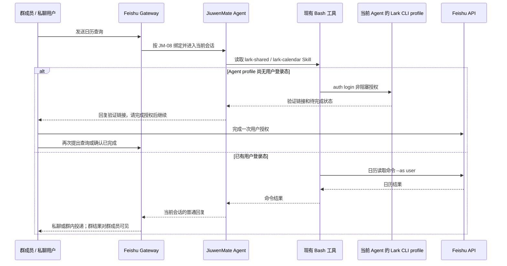

# JM-24 飞书 Agent 级用户授权与个人日历读取设计方案

## 1. 元信息

| 项 | 值 |
| --- | --- |
| 建档日期 | 2026-10-22 |
| 范围 | JiuwenSwarm Persistent Agent 的 Feishu Lark CLI 用户登录与只读个人日历访问 |
| 方案成熟度 | 已确认 |
| 计划条目 | JM-24 |
| 负责人 | 闫祉君 |
| 状态 | 进行中；实现与定向验证中，真实飞书授权和日历调用尚未验收 |
| 设计依据 | [JM-14 Lark CLI 运行时与 Skill 装配](F_14_workspace-read.md)、[JM-08 飞书接入与群内分发](F_08_feishu-group-fanout.md)、[JM-09 结果投递](F_09_web-and-feishu-result-delivery.md)、[S_02 Agent 级用户身份与个人数据访问规约](../specs/S_02_agent-user-identity.md) |
| 关联 feature | [F_11 群公共记录](F_11_group-public-records.md)、[F_21 跨群搜索](F_21_cross-group-search.md)；不改变其现有权限规则 |
| 验证摘要 | 已补充 Agent CLI 登录态保留和不装配专用日历工具的回归用例；本轮完整结果见 §8，真实飞书验证未执行 |
| Refs | 2026-10-22 用户确认：每个 Agent 共用一份 Lark CLI 用户登录态；群聊不做提问者隔离，也不增加私聊确认 |

## 2. 背景、目标与范围

### 2.1 背景与问题

JM-24 曾按“每个提问者单独 OAuth、群内私聊确认、再通过专用日历工具查询”的方向实现。这与 JiuwenSwarm 现有的 Agent 级 Lark CLI / Skill 使用方式不同，也让普通日历查询额外经过 Gateway OAuth、E2A 往返和确认卡片。

用户已确认采用 Agent 级共享授权：一个 Agent 使用自己私有的 Lark CLI 配置；该配置登录的飞书用户身份供该 Agent 的私聊和群聊请求共同使用。查询结果在当前会话回复；如果当前会话是群聊，群成员都能看到。

### 2.2 目标与关键场景

| 场景 / 触发条件 | 当前行为 | 目标行为 / 可观察变化 |
| --- | --- | --- |
| Feishu Agent 查询个人日历 | 专用工具按当前提问者 OAuth 授权 | 由已有 `lark-calendar` Skill 指导现有 Bash / `lark-cli`，以该 Agent 登录的用户身份只读查询 |
| Agent 尚未完成用户登录 | 专用 OAuth 流程并通过 Gateway 回调保存用户 Token | CLI 使用非阻塞登录流程生成验证链接；Agent 将链接发给用户，用户完成后再继续，不阻塞当前执行轮次 |
| 群成员在群中请求日历 | 先向提问者私聊发送确认卡片 | 不做额外确认，使用同一 Agent 的 Lark CLI 用户登录态查询，并在原群回复 |
| 同一 Agent 在不同会话使用日历 | 按请求者分别授权 | 私聊、群聊和该 Agent 获授权的其他群共用同一 CLI 用户登录态 |

### 2.3 本次范围与非目标

- 本次包含：放开 Agent 专属 Lark CLI profile 的用户身份登录；保留 Bot 作为默认身份；使用已有 Feishu Skills 与 Bash 读取个人日历；移除 JM-24 专用 `query_my_calendar` 工具、Gateway OAuth / 用户 Token 服务、群确认卡片和对应 E2A 请求响应链。
- 本次不包含：按当前提问者绑定身份、提问者本人确认、日历写操作、通用个人资料查询 API、授权管理页面、其他 IM 平台适配或 agent-core 改动。
- JM-11 仍归档正常投递到群里的公开结果；JM-21 仍只允许 Agent 在既有群授权范围内跨群搜索。本次不扩大 Agent 对群记录的访问授权。

## 3. 设计约束、假设与待决问题

- 已确认：一个 Agent 对应一个独立的 Lark CLI 配置目录；此 Agent 的用户登录态跨其会话共享，不按群或提问者拆分。
- 应用在飞书开发者平台获准申请用户身份日历只读权限，是 CLI 用户登录能够成功的前置条件；`app_id/app_secret` 绑定和 Bot 权限本身不等于用户已完成登录。
- 日历读取显式使用 `--as user`；应用级业务操作默认使用 `bot`。具体授权 scope 和登录参数遵循该 CLI 版本实际装配的 `lark-shared` / `lark-calendar` Skill，不由 Agent 自行扩大。
- 用户身份指曾在该 Agent CLI profile 中完成登录的飞书用户，不自动等于当前消息提问者。群查询不弹确认卡片，结果对群成员公开；这是已确认的产品行为，不是按用户隔离的授权保证。
- 本地提示词约束不等于 Bash 的系统级访问隔离。不得将其描述成抵御恶意命令的安全沙箱。
- 待真实验证：目标 Feishu 应用是否已发布并开放所需用户 scope；已安装的 Lark CLI 版本和 Skill 能否完成非阻塞授权、保存用户身份并成功查询日历。

## 4. 总体方案与设计取舍

### 4.1 方案概览

JM-14 已有的 `FeishuCliRuntime` 为每个 Agent 设置独立 `LARKSUITE_CLI_CONFIG_DIR`。JM-24 在该目录中保留同一个 Feishu 应用的 Bot 配置和 CLI 登录的用户身份：默认 `bot` 不变，但不再通过 `strictMode=bot` 禁止 `--as user`。现有 Feishu Skills 说明如何完成用户登录和调用日历命令；没有新增日历 Provider 或 Gateway API。

非阻塞登录的具体参数和恢复步骤以当前安装的 CLI Skill 为准。用户完成授权后，Agent 再检查登录状态；如果临时设备码或执行上下文已失效，则重新发起登录，而不是假报成功。

### 4.2 关键决策

#### D-01 使用 Agent 级 Lark CLI 用户登录态

- 选择与依据：复用 JM-14 已有的 per-Agent CLI profile 和 Feishu Skills；不为每次日历读取单独建设 Gateway OAuth 体系。
- 代价与成立条件：同一 Agent 的所有私聊和群聊共用同一已登录用户；需要由使用者明确知道并接受该账号及群内结果可见性。
- 实现体现：`FeishuCliRuntime._matches()` 接受 CLI 写入的用户登录记录；命令默认身份仍为 Bot，日历 Skill 显式切换到用户身份。

#### D-02 群聊不增加提问者身份隔离或确认卡片

- 选择与依据：按用户确认，完全采用 Agent 级共享授权方式；群内消息作为群成员可见内容处理。
- 代价与成立条件：任何能在 Agent 已加入的群里触发查询的成员，都可能触发读取该 Agent 登录用户可访问的日历信息，并看到群内回复。需要提问者隔离或群内隐私确认时，必须另行设计，不能声称当前实现已提供。

### 4.3 替代方案与排除理由

| 候选 / 关联决策 | 关键差异 | 拒绝或暂缓原因 |
| --- | --- | --- |
| Gateway 为每位提问者单独管理 OAuth Token | 身份按 `app_id + open_id` 隔离，并由宿主管理 Token 和确认流程 | 用户当前明确选择简化为 Agent 级 CLI 登录；此方案增加持久化、刷新、回调及群确认链路 |
| 每次群聊查询前私聊确认 | 查询前要求原提问者单独确认 | 用户明确要求按旧版流程直接查、直接在群内回复 |

## 5. 详细设计

### 5.1 模块责任与关键不变量

| 模块 | 责任 | 本次不承担的责任 |
| --- | --- | --- |
| `FeishuCliRuntime` | 为每个 Agent 准备固定 CLI 和独立配置目录；应用凭据仍由宿主写入私有文件；保留 CLI 后续写入的用户登录资料 | 不获取提问者身份、不向 Gateway 注册 OAuth callback、不判断查询者是谁 |
| `resource_assembly.apply_feishu_skills` | 装配 `lark-shared` 和领域 Skill 的使用说明，提示 Bot 默认身份与个人资源使用 `--as user` | 不创建日历工具，不保存 Token |
| `bash_runtime` | 继续通过已存在的 Bash 调用 `lark-cli`；命令环境指向当前 Agent 的 CLI profile | 不注册个人日历 Provider，不做用户级访问控制 |
| Feishu Gateway / JM-08、JM-09 | 保持既有消息入口和当前会话结果投递 | 不参与个人日历 OAuth 和用户 Token 转发 |
| JM-11 / JM-21 | 按既有规则归档及搜索公开群消息 | 不因消息来自日历查询而扩大群授权 |

必须保持：

1. 每个 Agent 的 `LARKSUITE_CLI_CONFIG_DIR` 仍独立；一个 Agent 的登录态不被另一个 Agent 复用。
2. Lark CLI 配置 `defaultAs` 仍为 `bot`；生成配置不带 root 或 app 级 `strictMode: bot`，否则显式 `--as user` 会被拒绝。
3. CLI 登录后 `apps[0].users` 可以非空；运行时检查不得把这当成配置变化或清除该登录态。
4. 日历读取使用 Skill 指引的只读授权范围和 `--as user`；未授权或权限不足时如实说明，不伪称“没有日程”。
5. 查询响应遵循当前会话：私聊只在私聊回复；群聊直接在当前群回复，群成员可见。不提供“仅提问者可见”的承诺。

### 5.2 配置与资源生命周期

- profile 路径：`<JiuwenMate 数据目录>/runtime/<namespace_id>/<agent_id>/lark-cli/config/`；Feishu app 绑定和 Secret 变化检测沿用 JM-14。
- `config.json` 中仍包含当前 app 和 `defaultAs: bot`。`strictMode` 不生成；`users` 初始为空列表，成功执行 CLI 用户登录后由 CLI 自己维护。
- 登录凭据由 Lark CLI 按其自身实现保存在此 Agent 的配置 / 数据上下文；不得复制到 Agent workspace、Session 草稿、日志或模型输出。
- Agent 解绑、删除或应用 Secret 变化时，已有 JM-14 清理和 profile 重建规则会使该 Agent 的 CLI 登录态失效；其他 Agent profile 不受影响。

### 5.3 登录和查询流程

1. 用户提出查询；Persistent Agent 读取 `lark-shared` 与 `lark-calendar` Skill。
2. 若 `auth status` 显示该 Agent 尚未有用户登录，按 Skill 运行非阻塞用户授权命令。将验证链接返回当前会话并结束本轮，不启动阻塞轮询；不输出 device code、Token 或配置文件内容。
3. 用户在飞书侧完成授权后再次发消息。Agent 依据 Skill 检查状态；完成后使用 `--as user` 执行日历只读命令。
4. CLI 结果由 Agent 整理成普通回复，通过已有当前会话投递链返回。群聊结果视为公开群消息，既有 JM-11 / JM-21 行为保持不变。
5. 登录失败、scope 不足、授权过期或 CLI 错误时，说明需要完成的用户步骤或缺少的应用权限；不要把错误当作空日历，也不要用 Bot 身份重试个人日历。

## 6. 影响面与实施设计

1. 修改 `jiuwenswarm/server/jiuwenmate/lark_cli_runtime.py`：取消 Bot-only 的严格模式校验和写入；允许 CLI 在同一 app 配置下维护用户登录状态；保留 `defaultAs=bot`、Agent 隔离路径及 Secret 保护。
2. 修改 `bash_runtime.py` 与 `resource_assembly.py`：移除 `query_my_calendar` Provider；更新工具提示和 Feishu Skill 说明，允许按 Skill 使用 Agent CLI profile 的用户身份读取日历。
3. 移除 JM-24 Gateway OAuth vault、私聊确认卡片、Web OAuth callback、personal-data E2A push/response 和 execution context 注入。普通消息/卡片、个人版和 JM-08/JM-09 的既有路由不变。
4. 同步本 feature、S_02 和 JM-24 开发计划；不改变 agent-core 公共接口或个人版上下文引擎。

## 7. 兼容与迁移

当前 JM-24 专用 Gateway 用户 Token、OAuth state 和待确认状态尚未作为已交付数据承诺；本次不迁移它们。若本地已有此实验实现生成的用户 Token vault，应先备份或清理该实验数据；它不再被新版调用。JM-14 已有 Bot CLI profile 保持原路径，删除 `strictMode` 仅扩大 CLI 可显式选择的身份，不改变默认 Bot 行为。

已发布配置可能仍包含 `jiuwenmate.personal_calendar`，直接移除 Provider 会使整个 Agent 构造失败。飞书能力刷新须清理顶层和 Bash 子工具中的该声明，并把宿主生成的“命令使用约定”段替换为当前 CLI 登录约定；其他工具、用户提示段和技能保留。清理后沿用 `save_capability_version` 创建新版本并切换当前版本，保留历史快照及未发布草稿；重复刷新不生成重复版本。其他未知工具仍按现有规则报错。已经失败的请求保持原状态，升级后需重新发送消息。

## 8. 验证设计、执行记录与结论

### 8.1 验证设计与通过条件

| ID | 验证场景 | 通过条件 |
| --- | --- | --- |
| JM-24-V-01 | Agent CLI profile 准备与登录后重载 | 配置默认 Bot、没有 Bot-only strictMode；模拟 CLI 写入 users 后状态仍为 ready，Skill 仍可用 |
| JM-24-V-02 | 工具注册与旧配置刷新 | 新发布和旧版本刷新均不包含 `query_my_calendar` 专用 Provider；旧宿主命令约定同步更新，历史版本及用户草稿保留；个人版 Shell Allowlist 不变 |
| JM-24-V-03 | 身份使用指引 | 已装配 Feishu Skill 的 Agent 生成提示允许按 Skill 对个人日历显式使用 `--as user`，且不含按提问者确认流程 |
| JM-24-V-04 | JM-08/JM-09 回归 | 普通 Feishu 消息分发和结果投递接线保持；无 personal-data E2A 消息或 OAuth callback 依赖 |
| JM-24-V-05 | 真实 Feishu | 一次完成 CLI 用户授权后，Agent 私聊和群聊均能查询同一登录用户的日历；群内结果直接可见；应用或用户 scope 不足时明确失败 |
| JM-24-V-06 | 个人版回归 | 普通 Bot CLI 行为、个人版 Feishu 路由和卡片处理不变 |

### 8.2 实际执行与证据

- 定向命令：`uv run pytest -q -o addopts='--asyncio-mode=auto --strict-markers --tb=short' -o log_cli=false tests/unit_tests/server/jiuwenmate/test_lark_cli_runtime.py tests/unit_tests/server/jiuwenmate/test_bash_runtime.py::test_bash_publication_includes_webpage_fetch tests/unit_tests/server/jiuwenmate/test_persistent_agent_service.py::test_custom_colleague_gets_its_own_core_template_and_first_version tests/unit_tests/server/jiuwenmate/test_resource_assembly.py::test_feishu_skill_prompt_uses_shared_agent_user_identity`。
- 实际结果：16 passed（13 项 CLI runtime、Bash Provider 装配、Agent 发布提示及 Feishu Skill 提示）。覆盖用户登录记录写入后 profile 仍 ready、默认 Bot 不变、无 Bot-only `strictMode`、不增加日历专用 Provider，且 Skill 提示使用同一 Agent 登录态并直接在群内回复。
- 已发布配置修复回归：执行 `.venv/Scripts/python.exe -m pytest -q -o addopts='--asyncio-mode=auto --strict-markers --tb=short' -o log_cli=false`，范围为 `test_cli_capability_publication.py`、`test_bash_runtime.py`、`test_persistent_agent_service.py`、`test_lark_cli_runtime.py` 及 `test_resource_assembly.py::test_feishu_skill_prompt_uses_shared_agent_user_identity`（均位于 `tests/unit_tests/server/jiuwenmate/`）。结果为 62 passed、1 failed；失败项 `test_public_views_never_carry_model_credentials` 的 Windows 文件权限断言得到 `0666` 而非 `0600`，不将该结果描述为全量回归通过。新增的顶层 / Bash 子工具旧配置迁移场景在修复前均失败、修复后均通过，覆盖保留插件工具、其他提示段、未发布草稿、历史快照和重复刷新不增加版本。
- 本机 SQLite 已通过 `publish_spec` 和 `save_capability_version` 升级 4 个受影响的 Agent；其中失败请求对应的架构助手从 `v6` 升至 `v7`，其他 3 个从 `v8` 升至 `v9`。新旧快照比较仅 `tools` 与 `system_prompt` 改变，草稿修订号及历史快照保持。使用这些真实新快照逐个调用 `create_persistent_agent`，4 个均成功构造；只进行构造，未调用模型、执行业务命令或投递消息，诊断用宿主端口拒绝读写。该结果只证明构造恢复，不代表真实飞书回复或日历 API 已验证。
- 较宽的多文件回归结果为 117 passed、6 failed：3 项在 Windows 创建符号链接时遇到权限错误，1 项 Windows 文件权限断言不符，1 项因显式清空 pytest `addopts` 而未启用异步测试模式，另 1 项知识页发布测试在失败后未找到预期占位同事。该结果不视为完整回归通过证据；最后一项尚待单独定位。
- 真实 Feishu 用户授权、日历 API、群内公开回复、JM-11 归档 / JM-21 搜索闭环和个人版回归尚未执行。

### 8.3 验证结论

当前是实现中，不能据此声称真实 Feishu 日历查询已闭环。只有定向测试通过，并在目标 Feishu 应用完成真实用户登录、日历读取和群内公开回复后，才可关闭 JM-24。

## 9. 风险与已知遗留

- **共享身份风险：** 一个 Agent 的用户授权不是当前提问者自己的授权。群成员可以触发查询并看到结果；若不能接受该行为，不应让这个 Agent 在相应群中提供个人日历能力。
- **CLI 状态保持：** 登录状态属于 Agent 的 CLI profile；应用绑定或 Secret 变更会触发 profile 重建，可能需要重新登录。
- **授权链接流程：** 非阻塞授权后，Agent 必须结束当前轮等待用户完成；用户回到对话后再检查。执行上下文若丢失临时设备码，应重新发起授权。
- **Bash 边界：** 系统提示约束 Agent 的正常调用方式，不构成抵御恶意命令访问本机文件的安全沙箱。
- **真实平台兼容：** 开发者后台应用用户 scope、CLI 发布版本和 Skill 所需 scope 必须匹配；任何不确定状态都不能折叠成“无日程”。

## 10. 设计演进与修订

### 2026-10-22 收敛为 Agent 级 CLI 用户登录

用户明确选择复用 Agent 私有 Lark CLI profile，不按提问者隔离，不在群聊查询前增加私聊确认。因而移除初版的 Gateway per-user OAuth、Token vault、专用日历工具、私聊确认卡片与 E2A 代理链；群聊结果按普通公开回复处理。

### 2026-10-22 已发布配置的废弃工具清理

本机失败请求复现确认：发布快照仍引用已删除的 `jiuwenmate.personal_calendar`，构造时抛出 `Unknown tool type`；仅在内存清理该声明后，同一快照成功构造。旧快照的宿主命令提示还包含 `query_my_calendar` 及禁止用户登录的过时约定。已在 `bash_runtime.refresh_builtin_tools` 和 `service.refresh_feishu_capability` 完成定向清理与提示更新，不恢复专用日历工具，不改写历史请求或发布用户草稿。新增迁移测试通过，本机 4 个 Agent 的新版本实际构造通过；完整结果及未覆盖范围见 §8.2。
