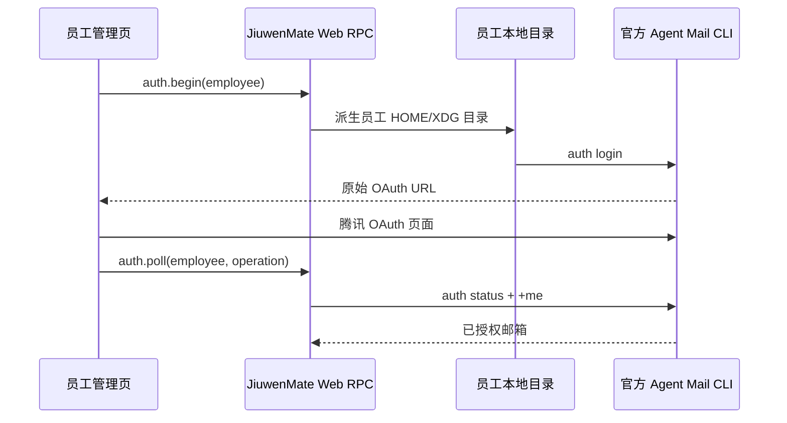

# 员工 Agent Mail 本地接入设计方案

| 项目 | 内容 |
| --- | --- |
| 关联计划 | JM-25 |
| 状态 | 实现完成，腾讯 OAuth 与真实邮箱读写待人工验收 |
| 目标 | 让每位 AI 员工可在管理页独立连接腾讯 Agent Mail，无需 Docker 或全局安装 CLI。 |

## 背景与范围

原方案要求部署 Docker Engine 和专用镜像，导致本地开发环境无法进入 OAuth 测试。现改为直接调用腾讯官方 `@tencent-qqmail/agently-cli@1.0.18`。每位员工使用独立运行目录，支持邮箱授权、状态查询、断开、删除清理，以及已连接员工的邮件读写操作。

## 方案

每位员工的 `(namespace_id, agent_id)` 经 SHA-256 派生为服务数据目录下的私有目录。每次 CLI 调用固定使用该目录的 `HOME`、`XDG_CONFIG_HOME`、`XDG_DATA_HOME`、`XDG_CACHE_HOME` 和 npm cache，因此不同员工不会复用配置文件或 npm 缓存路径。员工缓存中已有固定版本 CLI 时直接用 Node 启动缓存脚本，避免每次命令访问 npm；缓存缺失时回退至：

```text
npx --yes --package=@tencent-qqmail/agently-cli@1.0.18 agently-cli <command>
```

运行，不执行全局 `npm install`。授权时后端后台启动 `auth login`、从原始输出中提取腾讯授权 URL，页面在已打开的新窗口中跳转；完成后轮询 `auth status` 和 `+me`，只有两者均成功才将状态更新为 `connected`。



## 接口与状态

Web RPC 为 `jiuwenmate.agent_mail.status`、`auth.begin`、`auth.poll`、`auth.cancel`、`disconnect`。状态为 `not_connected`、`authorizing`、`connected`、`unavailable` 和 `error`。连接成功时状态还返回经 `+me` 核验的邮箱地址。Swarm 另用 `agent_mail_bindings` 保存员工与邮箱地址的唯一映射；同一命名空间内邮箱按去除首尾空白并忽略大小写后唯一，一个邮箱只能绑定一名员工，一名员工只登记一个邮箱。OAuth URL、token 和邮件正文不写入 JiuwenMate 数据库。

管理页邮箱说明只保留一句：为该员工单独连接腾讯邮箱，授权后即可在新对话中使用。状态为 `connected` 时，同一页标注已绑定地址。服务重新连上后，停留在邮箱页也会重新读取状态。同一邮箱再次授权给另一名员工时，先退出原员工的 CLI 登录，再把映射转到新员工，不拒绝本次连接，也不弹窗。取消授权、断开连接、确认未连接及删除员工时释放对应映射。

员工的后续 Execution 在状态为 `connected` 时注入 `agent_mail` 工具。支持 `mail.list`、`mail.search`、`mail.read`、`mail.attachment.read`、`mail.send`、`mail.reply`、`mail.forward` 和 `mail.delete`；参数经固定 allowlist 校验后转换为 CLI 参数，未知操作返回 `AGENT_MAIL_OPERATION_UNSUPPORTED`。发送、回复、转发与删除命令处理 CLI 返回的二次确认令牌；`mail.delete` 只将邮件移入废纸篓，不开放不可逆的永久删除。工具说明要求员工仅在用户明确要求时执行写操作。删除员工时删除其本地 CLI 目录和状态记录。

## 决策与限制

- 采用本地目录而不是 Docker：本地开发可直接测试且不增加部署依赖。
- 不采用全局 CLI：避免安装污染和版本漂移。
- CLI 若将凭据写入操作系统级 Keychain，该 Keychain 的跨目录隔离能力取决于腾讯 CLI 的实现；本次保证配置目录、OAuth 进程和运行参数按员工隔离。
- 腾讯 CLI 的四类写命令通过参数映射与二次确认测试；真实 OAuth、邮箱读写和跨员工授权仍需要用两个测试邮箱人工验收。

## 2026-10-23 补充：邮箱转绑与管理展示

- **D-02 邮箱身份以 CLI 核验值为准。** `+me` 返回的首个邮箱 alias 作为员工邮箱。同一时刻一个邮箱只登记在一名员工名下；再次授权给另一名员工时，映射从原员工转到新员工。
- **重复绑定处理：** `auth.poll` 或 `status` 发现该邮箱已登记在其他员工名下时，先断开原员工的 CLI 登录并把它标为未连接，再完成本次绑定。CLI 断开失败时仍转移映射，避免新员工授权被拒绝。腾讯侧切换后会吊销原员工的令牌；原员工的 `+me` 返回 401 时视为未连接并释放映射，而不是显示服务启动失败。
- **管理页面：** 连接状态下显示邮箱地址。不再因重复绑定弹出说明。
- **验证：** `test_agent_mail_runtime.py` 覆盖大小写不同的相同地址从原员工转到新员工；前端 Profile 测试确认邮箱页不再弹出重复绑定说明。

## 2026-10-23 补充：重启后保持同一凭据目录

官方 CLI 会按启动进程的宿主环境选择凭据子目录。从 Cursor 启动时登录写入 `codex`，之后在没有该环境的进程里查询会改看 `default`，已保存的登录因此显示为未连接。每次调用固定 `AGENTLY_WORKSPACE=jiuwenmate`。若该目录尚不存在且只有一个历史子目录，则在调用前把它改名为 `jiuwenmate`，使重启后仍能读到原来的登录。

## 验证

- 官方 CLI 的空目录 `auth status` 已实际运行，确认其前置提示和 JSON 响应均可被解析。
- `test_agent_mail_local_provider.py` 覆盖员工目录隔离、官方命令和 OAuth URL 提取。
- `test_agent_mail_runtime.py`、`test_web_adapter.py` 覆盖默认本地 provider、RPC 生命周期和工具门控。
- 前端 API/Profile 测试及生产构建覆盖页面调用和文案。
